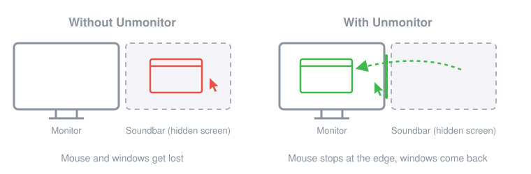
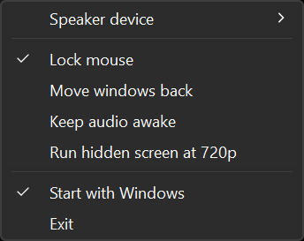

<p align="center">
  <picture>
    <source media="(prefers-color-scheme: dark)" srcset="docs/logo-dark.png">
    
  </picture>
</p>

<h1 align="center">Unmonitor</h1>

<p align="center">Use HDMI audio from an AV receiver or soundbar on Windows without the extra monitor getting in the way.</p>

<p align="center">
  <a href="../../releases/latest"></a>
  
  <a href="LICENSE.md"></a>
</p>

When a receiver or soundbar is connected to a PC over HDMI, Windows treats it as a second display. Turning that display off also turns off the audio. Leaving it on in Extend mode means the mouse and windows keep disappearing onto a screen you can't see. Duplicate mode keeps the audio, but it often messes up resolution and refresh rate, and some games pick the receiver as the main screen. This is sometimes called the phantom or ghost monitor problem.

Unmonitor leaves the display enabled, so audio keeps working, and makes Windows behave as if it weren't there.

<p align="center">
  
</p>

## What it does

- **Lock mouse**: the cursor stops at the edge of your real monitors.
- **Move windows back**: windows that open on the speaker's screen, or get moved there, are moved to the monitor you are using. Maximized windows stay maximized.
- **Keep audio awake**: keeps a silent stream open on the HDMI audio device so the receiver doesn't drop the link, which otherwise cuts off the start of sounds. It stops after a minute without keyboard or mouse input so the PC can still go to sleep.
- **Run hidden screen at 720p**: lowers the speaker's screen to 1280x720 so the GPU isn't drawing an invisible 4K desktop. Turning it off restores the previous mode. In my tests the GPU used a few watts less on the desktop. Don't expect a noticeable FPS gain in games.
- **Start with Windows**

The menu is in English, or in Turkish when Windows is set to Turkish.

## Usage

1. Download `unmonitor.exe` from [Releases](../../releases) and run it. There is no installer.
2. Right-click the tray icon (it may be hidden under the `^` arrow) and choose your receiver or soundbar under **Speaker device**.

<p align="center">
  
</p>

Settings are saved in `%APPDATA%\Unmonitor\config.ini`.

The exe is not code-signed, so SmartScreen may warn about it. Click **More info**, then **Run anyway**, or build it yourself. The v0.1.0 exe scanned clean on [VirusTotal](https://www.virustotal.com/gui/file/e90c78b79c03a398d074ba54c7023182d483506b7a76f5bca774f1ffb820010f) (0/71).

## Requirements

Windows 10 (1903 or later) or Windows 11, with the displays in Extend mode. Tested on Windows 11 with an NVIDIA GPU and an LG soundbar.

## Limitations

- Windows of programs running as administrator can't be moved unless Unmonitor also runs as administrator.
- Some games read the mouse directly, so the mouse lock doesn't apply to them.
- Keep audio awake finds the audio device by the name Windows gives it, like `LG-SBAR (NVIDIA High Definition Audio)`. If you rename it in Sound settings, that feature stops working.

## Building

Needs Rust with the MSVC toolchain.

```
cargo build --release
```

The exe ends up in `target\release\unmonitor.exe`.

## License

[PolyForm Noncommercial 1.0.0](LICENSE.md). Free for personal and other noncommercial use. Commercial use, including selling it or a modified version, is not allowed.

Required Notice: Copyright 2026 Kubilay Karacar
